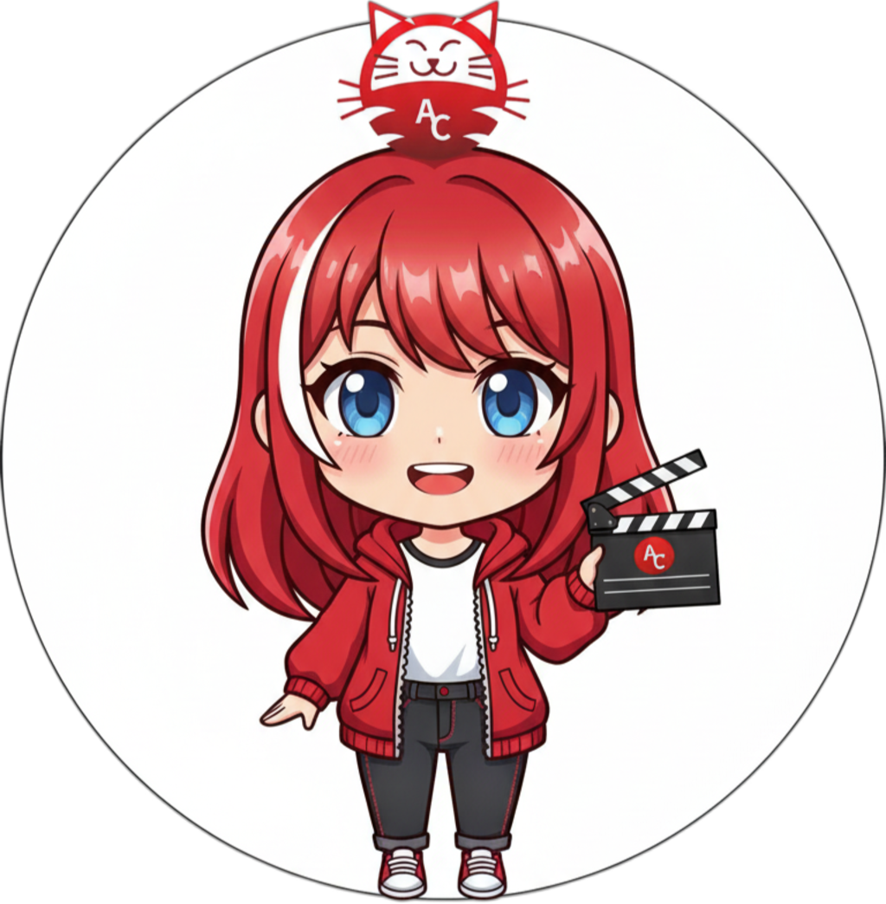
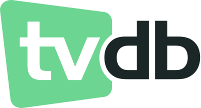

# AnimeClick Metadata per Jellyfin

<p align="center">
  
</p>

<p align="center">
  <strong>Tutti i tuoi anime in italiano su Jellyfin.</strong><br />
  Titoli, trame, episodi, cast, generi e locandine ad alta definizione con un solo plugin, guidato da <strong>AnimeClick.it</strong>.
</p>

<p align="center">
  <a href="https://github.com/iCosiSenpai/jellyfin-plugin-animeclick/releases/latest"></a>
  <a href="https://github.com/iCosiSenpai/jellyfin-plugin-animeclick/actions/workflows/build.yml"></a>
  <a href="#installazione"></a>
  <a href="LICENSE"></a>
</p>

<p align="center">
  <a href="#installazione">Installa in 1 minuto</a> ·
  <a href="#primo-avvio">Primo avvio</a> ·
  <a href="#il-pannello-di-controllo">Pannello di controllo</a> ·
  <a href="#come-lavorano-le-fonti">Fonti integrate</a> ·
  <a href="#comunit%C3%A0">Comunità</a> ·
  <a href="#domande-frequenti">Domande frequenti</a> ·
  <a href="https://github.com/iCosiSenpai/jellyfin-plugin-animeclick/issues">Segnala un problema</a>
</p>

---

## Perché usare AnimeClick Metadata

Organizzare una libreria anime in italiano su Jellyfin richiede spesso di combinare più plugin diversi, ritrovandosi comunque con titoli in inglese, trame mancanti o stagioni accorpate male. **AnimeClick Metadata** risolve il problema alla radice:

- **L'enciclopedia italiana degli anime come prima fonte:** importa titoli italiani, trame, generi, tag, sigle (opening ed ending) e titoli degli episodi direttamente da **AnimeClick.it**, senza bisogno di chiavi o registrazioni.
- **Un solo plugin per tutta la libreria anime:** integra già al suo interno **AniList**, **TMDB**, **TheTVDB** e **Fanart.tv**. Non devi installare altri plugin separati per avere il cast giapponese, lo studio d'animazione, i trailer, i loghi o gli sfondi in 4K.
- **Traduzione AI automatica quando manca l'italiano (opzionale):** se un episodio appena uscito ha il titolo o la trama solo in inglese, il plugin può tradurlo automaticamente in italiano tramite il servizio AI che preferisci (in cloud o in locale sul tuo server).
- **Sicuro e rispettoso della tua collezione:** non inventa mai titoli o trame quando un dato manca, rispetta sempre i campi che hai bloccato manualmente in Jellyfin e verifica che tipo di opera, anno e numero di episodi coincidano prima di collegare una scheda o una stagione.

---

## Installazione

> [!IMPORTANT]
> **Requisiti:** il plugin funziona esclusivamente con **Jellyfin 12.0 o successivo** (.NET 10), verificato su Jellyfin 12.0 e 12.1. Le vecchie versioni `0.x` per Jellyfin 10.x sono obsolete e non più supportate: se usi ancora Jellyfin 10, aggiorna prima il server alla versione 12 e poi installa il plugin dal catalogo.

### Dal catalogo Jellyfin (consigliata)

È il metodo più semplice: Jellyfin scarica il plugin da solo e ti avvisa a ogni nuovo aggiornamento.

1. Apri Jellyfin e vai in **Dashboard → Plugin → Repository**, quindi premi il pulsante **Aggiungi** (`+`).
2. Compila i due campi così:
   - **Nome repository:** `iCosiSenpai Plugins`
   - **URL repository:**
     ```text
     https://raw.githubusercontent.com/iCosiSenpai/iCosiSenpai-Plugins/main/manifest.json
     ```
3. Premi **Salva**, apri la scheda **Catalogo** in alto e cerca **AnimeClick Metadata**.
4. Premi **Installa**, **riavvia Jellyfin** e apri le impostazioni del plugin dalla Dashboard.

<details>
<summary><strong>Installazione manuale da file ZIP (alternativa senza catalogo)</strong></summary>

Se preferisci installare manualmente una versione specifica:

1. Scarica il pacchetto `AnimeClick.Plugin.zip` dall'[ultima release ufficiale](https://github.com/iCosiSenpai/jellyfin-plugin-animeclick/releases/latest).
2. Ferma Jellyfin e conserva una copia di sicurezza della tua configurazione.
3. Se avevi installato versioni precedenti a mano, sposta le vecchie cartelle di AnimeClick **fuori dalla cartella `plugins`**. Estrai il contenuto dello ZIP in un'unica sottocartella dentro `plugins` (usa sempre lo ZIP ufficiale, che include `AnimeClick.Plugin.dll`, `HtmlAgilityPack.dll`, `meta.json`, `LICENSE` e `NOTICE`).
4. Riavvia Jellyfin e apri le impostazioni del plugin dalla Dashboard.

</details>

---

## Primo avvio

La prima volta che apri la pagina del plugin troverai una **configurazione guidata** in tre passaggi rapidi:

1. **Collega le fonti:** inserisci la chiave gratuita **TMDB** (consigliata per riconoscere subito le opere e scaricare le immagini originali) e, se vuoi, la chiave personale **Fanart.tv** o un servizio di **Traduzione AI**. Puoi verificarne il funzionamento all'istante con un clic.
2. **Scegli le tue preferenze:** le opzioni consigliate per avere la libreria in italiano sono già selezionate. Puoi disattivare liberamente ciò che non ti interessa.
3. **Attiva nelle librerie anime:** spunta le librerie che contengono i tuoi anime e premi **Attiva nelle librerie scelte**. AnimeClick diventerà il primo fornitore di metadati per serie, stagioni, episodi e film in quelle librerie, lasciando intatte le altre cartelle del tuo server.

> [!TIP]
> **Nessuna sorpresa dopo gli aggiornamenti:** l'installazione non modifica né avvia scansioni automatiche sulla tua libreria senza il tuo permesso. Inoltre, quando una nuova versione introduce una funzione che richiede una tua scelta, il setup guidato ti mostrerà **solo il singolo passo nuovo**, senza farti rifare la configurazione da capo.

---

## Il pannello di controllo

Una volta completato il primo avvio, la pagina del plugin ti mette a disposizione quattro aree pensate per gestire la collezione in modo visivo e immediato:

### 1. Inizio (Vetrina e Cruscotto)
Mostra in primo piano la **vetrina degli ultimi anime aggiornati** con locandina, trama e generi, affiancata dal **cruscotto della collezione**: vedi subito la percentuale della tua libreria già in italiano, lo stato delle fonti collegate, le librerie attive e le eventuali attività in corso.

### 2. Libreria e «Sistema tutti i titoli»
Esplora tutti gli anime della tua collezione in una **griglia di locandine** che indica chiaramente dove mancano titoli o trame in italiano. Cliccando su un anime puoi ispezionare stagione per stagione lo stato di ogni episodio.
- **L'analisi è in sola lettura:** controllare la libreria non modifica alcun dato finché non sei tu a chiederlo.
- **Sistema tutti i titoli:** con un clic il plugin passa in rassegna gli episodi con nomi vuoti, generici (come *"Episodio 12"* o il nome del file) oppure rimasti in inglese. Cerca prima il titolo italiano su AnimeClick e nelle fonti collegate; se trova solo il titolo inglese coerente con quell'episodio e hai attivato l'AI, lo traduce in italiano. Scrive **esclusivamente il titolo**, senza toccare trame, immagini, numerazione o campi bloccati, e puoi seguire o interrompere il lavoro dal riquadro **Attività**.

### 3. Correggi un abbinamento
Se un film o una serie ha un titolo ambiguo e non è stato abbinato alla scheda giusta, apri **Strumenti → Correggi un abbinamento** (oppure premi **Correggi abbinamento** direttamente dalla scheda dell'anime in *Libreria*):
- Scegli l'opera dalla tua libreria e cerca il nome su AnimeClick, oppure incolla direttamente l'indirizzo della scheda di AnimeClick.it.
- **Anche per singola stagione:** se una stagione ha una scheda tutta sua su AnimeClick (come accade spesso per i sequel o gli archi finali), seleziona la stagione nel menu **Cosa correggere**: la serie principale terrà la sua scheda e quella stagione userà la scheda dedicata.

### 4. Preferenze e Fonti
Tutte le impostazioni sono raccolte in schede ordinate (**Preferenze** e **Fonti**), dove puoi accendere o spegnere ogni singolo elemento (titoli, trame, generi, cast, sigle, collezioni), scegliere il modello di traduzione AI con il pulsante **Elenca modelli** e salvare con la barra in fondo alla pagina. Se vuoi usare AnimeClick come **unico** provider remoto per le librerie anime, ti basta disattivare gli altri provider remoti dalle impostazioni della libreria di Jellyfin (lasciando attivi lettori NFO o immagini locali se li usi).

---

## Come lavorano le fonti

Il plugin unisce il meglio di più servizi **campo per campo**, dando sempre la precedenza ad AnimeClick per la lingua italiana:

| Fonte | Cosa porta nella tua libreria | Richiede una chiave? |
|---|---|---|
| **AnimeClick.it** | Titoli italiani, trame, generi, tag, sigle, relazioni e titoli degli episodi | **No** *(sempre attiva)* |
| **AniList** | Cast giapponese con personaggi, studio d'animazione, date, voti, trailer, copertine, banner e collegamento automatico delle stagioni sequel | **No** *(si attiva in Fonti / Setup)* |
| **TMDB** | Riconoscimento preciso delle opere, completamento di trame/titoli e locandine o sfondi a risoluzione originale | Sì ([Chiave gratuita TMDB](https://developer.themoviedb.org/docs/getting-started)) |
| **Fanart.tv** | Sfondi fino al 4K, loghi trasparenti (ClearLogo), banner e artwork dedicati per le stagioni | Sì ([Chiave personale gratuita Fanart](https://fanart.tv/get-an-api-key/)) |
| **TheTVDB** | Fonte aggiuntiva per titoli e trame degli episodi in italiano o in inglese | Sì ([Chiave API TheTVDB](https://thetvdb.com/dashboard), opzionale) |
| **Traduzione AI** | Traduzione automatica in italiano delle trame e dei titoli disponibili solo in inglese | Credenziali del servizio scelto (o gratis in locale con Ollama) |

**Ordine di priorità automatico:**
- **Testi (titoli, trame, generi):** `AnimeClick` → altre fonti in italiano (`TheTVDB` / `TMDB`) → traduzione AI dei testi inglesi (`TMDB` / `TheTVDB`). I nomi propri, gli ID e i numeri non vengono mai alterati.
- **Informazioni sull'opera (cast, studio, date, voto, trailer):** `AnimeClick` → `AniList` → `TMDB` (solo nei campi ancora vuoti).
- **Immagini e locandine:** `Fanart.tv` → `TMDB` → `AniList` → locandina `AnimeClick` (con filtro automatico sulle locandine a bassa risoluzione).

---

## Comunità

Quando correggi l'abbinamento di un anime o di una stagione, il tuo intervento può aiutare tutti gli altri utenti del plugin — **senza creare account e senza esporre alcun dato del tuo server**.

- **Ricevere gli abbinamenti approvati:** attivando **Usa gli abbinamenti della comunità**, il plugin scarica una volta al giorno la lista curata degli abbinamenti. Viene usata **solo** per gli anime o le stagioni che non hanno ancora un ID AnimeClick e non sovrascrive mai le tue scelte. Per le stagioni, l'abbinamento viene applicato solo se sia il numero di stagione sia il numero di episodi nella tua libreria coincidono esattamente con quelli registrati.
- **Condividere una correzione:** dopo aver corretto un abbinamento, il plugin ti mostra in trasparenza i soli codici numerici che verrebbero inviati e ti lascia scegliere tra **Condividi**, **Non ora** o **Non chiedere più** (puoi cambiare la preferenza in ogni momento nella scheda **Comunità**).
- **Privacy garantita:** partono **esclusivamente ID numerici pubblici** (ID AnimeClick, TMDB, TheTVDB o AniList, più numero di stagione e conteggio episodi). Non vengono mai inviati titoli, nomi di file, cartelle, indirizzi IP, utenti, trame o immagini. Ogni proposta supera verifiche automatiche e la revisione del curatore prima di entrare nella lista comune. Per tutti i dettagli tecnici consulta [community/README.md](community/README.md).

---

## Domande frequenti

| Situazione | Come risolvere |
|---|---|
| **Un anime non viene riconosciuto o ha la scheda sbagliata** | Verifica in **Inizio → Librerie** che AnimeClick sia attivo per quella libreria, poi apri **Strumenti → Correggi un abbinamento** e seleziona la scheda corretta. |
| **Mancano i titoli o le trame di alcuni episodi** | Apri la scheda **Libreria** per vedere cosa manca e avvia **Sistema tutti i titoli**. Se su AnimeClick l'episodio non ha ancora una trama, verifica in **Fonti** di aver inserito la chiave TMDB e, per gli episodi disponibili solo in inglese, di aver configurato la **Traduzione AI**. |
| **Un titolo o una trama non cambia anche aggiornando i metadati** | Controlla nell'editor metadati di Jellyfin che il campo non abbia il lucchetto attivo (**Bloccato**). Ricorda inoltre che *Sistema tutti i titoli* conserva per prudenza i titoli già in italiano o dalla lingua incerta. |
| **La pagina del plugin resta bianca dopo un aggiornamento** | Riavvia il server Jellyfin e ricarica la pagina del browser svuotando la cache (`Ctrl+F5` o `Cmd+Shift+R`). Se avevi installato vecchie versioni manualmente, assicurati che non ci siano cartelle duplicate dentro `plugins`. |
| **Dove vengono salvate le chiavi e cosa viene inviato all'AI?** | Le chiavi API restano salvate nella configurazione amministrativa del tuo server Jellyfin e non lasciano il server, salvo verso il rispettivo servizio. La traduzione AI invia al fornitore scelto esclusivamente il testo inglese da tradurre (eventuali costi dipendono dal fornitore scelto). |

Hai trovato un bug o un caso particolare? **[Apri una segnalazione su GitHub](https://github.com/iCosiSenpai/jellyfin-plugin-animeclick/issues)** indicando la versione di Jellyfin, la versione del plugin, il link della scheda AnimeClick, come sono numerati gli episodi e il risultato che ti aspettavi *(ricorda sempre di rimuovere chiavi API, token e percorsi personali dai log prima di incollarli)*.

---

## Documentazione tecnica

[Novità delle versioni (Changelog)](CHANGELOG.md) · [Audit e verifiche 1.6.1](docs/AUDIT-1.6.1.md) · [Procedura di rilascio](docs/RELEASING.md) · [Pipeline di test e CI](.github/workflows/build.yml)

---

## Copyright, fonti e licenze

### Plugin e identità del progetto

**Copyright (C) 2026 Alessio Cosi (iCosiSenpai).** Dalla versione 1.6.0.0 il codice è distribuito sotto **[GNU AGPL v3](LICENSE)**, con i termini aggiuntivi descritti in **[NOTICE](NOTICE)**; le versioni fino alla 1.5.0.0 restano sotto GPLv3. Il plugin usa le librerie Jellyfin GPL-3.0-only, che la sezione 13 delle due licenze permette di combinare con l'AGPL. Chi modifica e distribuisce il codice deve rispettare la stessa licenza e renderne disponibili i sorgenti; con l'AGPL questo vale anche per chi fa usare una versione modificata attraverso la rete, per esempio da un server Jellyfin condiviso.

Termini aggiuntivi (sezione 7 dell'AGPLv3), in sintesi:

- **Attribuzione:** una versione modificata deve mantenere nella pagina del plugin la dicitura «Basato su AnimeClick Metadata Plugin di Alessio Cosi (iCosiSenpai)» con il collegamento a questo repository.
- **Versioni modificate riconoscibili:** nome, GUID del plugin e User-Agent devono essere propri, così le richieste di un fork verso AnimeClick.it e le altre fonti non si confondono con quelle di questo progetto; le proposte inviate al servizio della comunità non possono presentarsi come provenienti da questo plugin.
- **Marchi:** nome, logo, banner, **mascotte**, servizio della comunità e identità **iCosiSenpai** identificano questo progetto e non possono essere usati per presentare un fork come l'originale o come approvato dall'autore. I file restano ridistribuibili con il programma; un fork deve avere nome, identità visiva e mascotte propri.

### AnimeClick e autorizzazione allo scraping

<a href="https://www.animeclick.it/"></a>

I metadati italiani provengono da **[AnimeClick.it](https://www.animeclick.it/)**, gestito dall'associazione culturale senza fini di lucro **[Associazione NewType Media](https://www.antme.it/)**. Il marchio, il logo e i contenuti appartengono ai rispettivi titolari; il plugin non rivendica diritti su di essi e non è affiliato con AnimeClick.

Salvo diversa indicazione, i contenuti redazionali su cui l'associazione possiede i diritti sono distribuiti sotto **[CC BY-NC-ND 4.0](https://creativecommons.org/licenses/by-nc-nd/4.0/)**. Questa licenza non si estende automaticamente a immagini, video, marchi o materiali di terzi: valgono i [termini di AnimeClick](https://www.animeclick.it/termini-di-servizio).

Lo staff AnimeClick ha autorizzato **questo progetto** allo scraping per uso non commerciale. L'autorizzazione è personale e **non trasferibile**: un fork non eredita il consenso e deve ottenere il proprio. Il plugin limita le richieste, usa la cache e non importa i commenti degli utenti come sinossi. Mantieni queste protezioni e non usarlo per raccolte massive o finalità commerciali. I dettagli dell'autorizzazione sono in **[NOTICE](NOTICE)**.

### Provider integrati e piattaforma

I loghi ufficiali sono riportati per identificare le fonti. Marchi, dati e immagini restano soggetti ai diritti dei rispettivi titolari e alle condizioni dei servizi; la licenza del plugin non li rende contenuti GPL.

| Fonte | Attribuzione e condizioni |
|---|---|
| <a href="https://www.themoviedb.org/"></a> | **TMDB / The Movie Database.** This product uses the TMDB API but is not endorsed or certified by TMDB. [Attribuzione e marchio](https://developer.themoviedb.org/docs/faq) · [Termini API](https://www.themoviedb.org/api-terms-of-use) |
| <a href="https://thetvdb.com/"><picture><source media="(prefers-color-scheme: dark)" srcset="assets/providers/thetvdb-dark.png" /></picture></a> | **© 2026 TheTVDB.com®, A Whip Media Company. All rights reserved.** Metadata provided by TheTVDB. Please consider adding missing information or [subscribing](https://thetvdb.com/subscribe). [Attribuzione e condizioni API](https://www.thetvdb.com/api-information) |
| <a href="https://fanart.tv/"></a> | **Fanart.tv.** Artwork provided by Fanart.tv. I diritti sulle immagini restano ai rispettivi titolari. [Condizioni d'uso](https://fanart.tv/terms-and-conditions/) |
| [Jellyfin](https://jellyfin.org/) | **Copyright Jellyfin Contributors.** Piattaforma e librerie `Jellyfin.Controller` / `Jellyfin.Model`, sotto GPL-3.0-only. |

La traduzione AI, se attivata, usa il servizio scelto dall'utente ed è soggetta ai suoi termini. **HtmlAgilityPack** è di **ZZZ Projects Inc.**, sotto licenza MIT; **Microsoft.Extensions.*** usa licenze MIT. Le attribuzioni e il testo MIT della DLL inclusa sono conservati in **[NOTICE](NOTICE)**, distribuito anche nello ZIP del plugin.

Origine dei loghi e condizioni d'uso: **[assets/README.md](assets/README.md)**.

[Buy Me a Coffee](https://buymeacoffee.com/iCosiSenpai) · [PayPal](https://www.paypal.com/donate/?hosted_button_id=5A4E26XC45GLQ)
